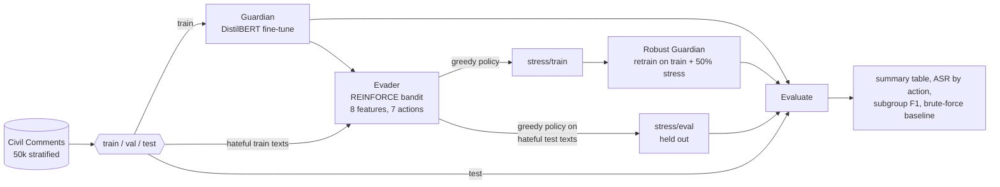

# Red Queen Moderation

[](https://github.com/MarkoStc/Deep-learning-EE-559-EPFL-Project/actions/workflows/ci.yml)


**A reinforcement-learning attacker that finds the text edits a hate-speech classifier misses, and a held-out test of how much retraining on them really fixes.**

Moderation classifiers are usually tested on clean text, but people who want
to get past them write `h4te`, swap in Cyrillic look-alike letters, or hide
zero-width characters inside words. This project measures that gap
systematically. An **Evader** (a contextual bandit trained with REINFORCE)
learns which of seven surface perturbations makes a **Guardian** (fine-tuned
DistilBERT) label hateful comments as safe. The perturbed texts become stress
cases, the Guardian is retrained on them, and the two can be run against each
other for several rounds (the "Red Queen" arms race).

## How it works



Actions: `noop`, `typo`, `leetspeak`, `whitespace` (zero-width characters),
`homoglyph` (Cyrillic look-alikes), `synonym` (WordNet), `emoji`. Reward is 1
when the Guardian calls a perturbed hateful text safe. No new hateful text is
generated: every action edits a comment that is already in the dataset.

Each step writes into one run directory (`runs/<timestamp>-<label>/`) with its
config, metadata and a manifest of artifacts, so steps chain without copying
paths and an interrupted run continues where it stopped.

## Quickstart

```bash
uv sync --extra cpu                                    # or --extra cu126 for CUDA 12.6
uv run red-queen pipeline --config configs/smoke.yaml  # whole pipeline, synthetic data, about 1 min on CPU
uv run red-queen pipeline                              # the real experiment on Civil Comments (GPU recommended)
```

[uv](https://docs.astral.sh/uv/) installs Python 3.12 and the locked
dependencies. The smoke config uses a tiny randomly initialised model and
generated sentences, so it needs no downloads; its numbers only show that the
code runs.

Other commands:

```bash
red-queen train --set guardian.epochs=1                  # one step, any config value overridden
red-queen evader --run-dir runs/<id>                     # continue an existing run
red-queen arms-race --run-dir runs/<id> --rounds 5       # multi-round Evader vs Guardian
red-queen baseline --run-dir runs/<id>                   # every action on every hateful test text
red-queen compare --checkpoint a=PATH --checkpoint b=PATH --action leetspeak
red-queen predict --checkpoint runs/<id>/guardian/best "text to classify"
```

## Results

All numbers below come from the two Guardian checkpoints trained in the
original course run (`outputs/run_029`, `outputs/run_031`), re-scored with
this code. Report files: [`results/2026-10-14-course-checkpoints-held-out/`](results/2026-10-14-course-checkpoints-held-out/).
Reproduce (about 80 minutes on a laptop CPU, downloads Civil Comments once):

```bash
uv run red-queen compare \
  --checkpoint baseline=outputs/run_029/guardian_best \
  --checkpoint robust=outputs/run_031/guardian_robust \
  --action leetspeak
```

**Clean test set** (7,500 comments, 600 labelled hate). These match the course
report to four decimals, with identical confusion matrices, which checks that the
rewritten data split and inference are equivalent to the original code.

| Model | Macro-F1 | Hate F1 | Hate precision | Hate recall |
|---|---|---|---|---|
| Baseline | 0.8098 | 0.6486 | 0.6820 | 0.6183 |
| Robust | 0.8041 | 0.6373 | 0.6907 | 0.5917 |

**Held-out stress set:** the 600 hateful *test* comments, rewritten with
leetspeak (the only action the course Evader ever chose) and never seen in
training. *ASR* (attack success rate) is the share of hateful comments
labelled safe after the edit; *conditional ASR* only counts comments the model
caught before the edit.

| Model | Hate recall under attack | ASR | Conditional ASR |
|---|---|---|---|
| Baseline | 0.0367 | 0.9633 | 0.9407 |
| Robust | 0.9967 | 0.0033 | 0.0000 |

**Every action on every hateful test comment** (brute-force baseline,
conditional ASR):

| Model | typo | leetspeak | homoglyph | synonym | emoji | whitespace | any action (raw ASR) |
|---|---|---|---|---|---|---|---|
| Baseline | 0.350 | 0.938 | 0.731 | 0.129 | 0.032 | 0.000 | 0.982 |
| Robust | 0.335 | 0.009 | 0.448 | 0.144 | 0.025 | 0.000 | 0.802 |

What this shows:

- Leetspeak alone flips 94% of the hateful comments the baseline detects.
- Retraining on leetspeak stress cases removes that weakness on unseen
  comments, at a cost of 0.6 points of clean macro-F1. The course report's
  0.9964 recall came from a leaky protocol (stress cases overlapping the
  retraining data, see [ADR 0003](docs/adr/0003-held-out-stress-evaluation.md)),
  but the held-out number confirms it for this action.
- The robust model is still fooled by Cyrillic homoglyphs (45% of detected
  comments) and typos (34%). Because the course Evader collapsed to a single
  action, retraining closed that one hole and left the others open; trying
  every action still evades the robust model on 80% of hateful comments
  (including the 41% it misses without any edit). The multi-round
  `arms-race` exists to close these one round at a time; it has not yet been
  run on Civil Comments.
- Zero-width whitespace gives exactly the same predictions as no edit, which is
  what the BERT normaliser removing Unicode format characters would produce.

## Project structure

```
configs/            default.yaml (course hyperparameters), smoke.yaml (CPU check)
src/red_queen/
  config.py         typed config (pydantic), --set overrides
  data.py           Civil Comments / HateXplain / synthetic sources, cache, splits
  guardian.py       classifier wrapper, offline tiny model
  training.py       GuardianTrainer: best-epoch checkpoints, per-epoch resume
  perturbations.py  the 7 actions, each with an explicit RNG
  features.py       8-dim Evader state
  evader.py         bandit env, policy, REINFORCE trainer
  stress.py         stress-case generation, brute-force baseline
  evaluation.py     metrics per model, report files, plots
  pipeline.py       the five steps over one run directory
  arms_race.py      multi-round loop
  compare.py        score saved checkpoints under the held-out protocol
  cli.py            red-queen command
tests/              unit and end-to-end tests (CPU, no network)
docs/               model card, data card, ADRs
outputs/            archived results and checkpoints of the original course run
results/            reports produced by this code, each with the command that made it
```

## Testing

```bash
make check        # ruff, strict mypy, pytest with coverage
make test-fast    # skip the end-to-end tests (marked slow)
make smoke        # the CLI pipeline on synthetic data
```

Tests never use the network or a GPU: Hub downloads, WordNet and the classifier
are replaced by fakes or by the tiny offline model. CI runs lint and type
checks, tests on Python 3.11 to 3.13, the smoke pipeline, a dependency audit,
and builds the CPU and CUDA Docker images.

## Docker

```bash
docker build --target cpu -t red-queen:cpu .
docker run --rm -v "$PWD/runs:/app/runs" red-queen:cpu pipeline --config configs/smoke.yaml
docker build --target cuda -t red-queen:cuda .       # CUDA 12.6, run with --gpus all
```

`docker compose run --rm red-queen pipeline` does the same with `runs/`,
`data/` and the Hugging Face cache mounted. GPU cluster jobs (RunAI) go through
`scripts/run_cluster.sh`, configured from `.env` (see `.env.example`).

## Roadmap

- Rerun the full pipeline and a 5-round arms race on Civil Comments under the
  held-out protocol, and publish the numbers with their run directories.
- Richer Evader state (Guardian attention or token saliency instead of
  handcrafted features), so the policy can choose per text instead of
  collapsing to one action.
- Combined actions and a readability constraint on perturbed text.
- An adaptive evaluation: an Evader retrained against the robust Guardian.

## Ethics

- Perturbations only rewrite characters or words of comments that are already
  in the dataset and already labelled.
- Logged and sampled examples are masked. Stress-case files with raw text stay
  in git-ignored run directories.
- The project follows the UN definition of hate speech and the EPFL ethics
  guidelines given in the course.
- See the [model card](docs/model_card.md) and [data card](docs/data_card.md)
  for limits and known biases.

## Authors

Built as a three-person mini-project for **EE-559 Deep Learning at EPFL**
(2026) by Marko Stojanovic and two teammates.
<!-- TODO(Marko): add the two co-authors' names (they are not recorded in the repo). -->

The packaging, typed config, tests, CI, Docker image, resumable pipeline, CLI
and the held-out evaluation fix were added after the course by Marko
Stojanovic, with help from Claude Code (see the commit trailers). The code as
submitted for the course is tagged
[`v0-original`](https://github.com/MarkoStc/Deep-learning-EE-559-EPFL-Project/tree/v0-original).

## Licence

Academic use only (EPFL EE-559 course project). No open-source licence has
been chosen yet; that needs the agreement of all three authors.
